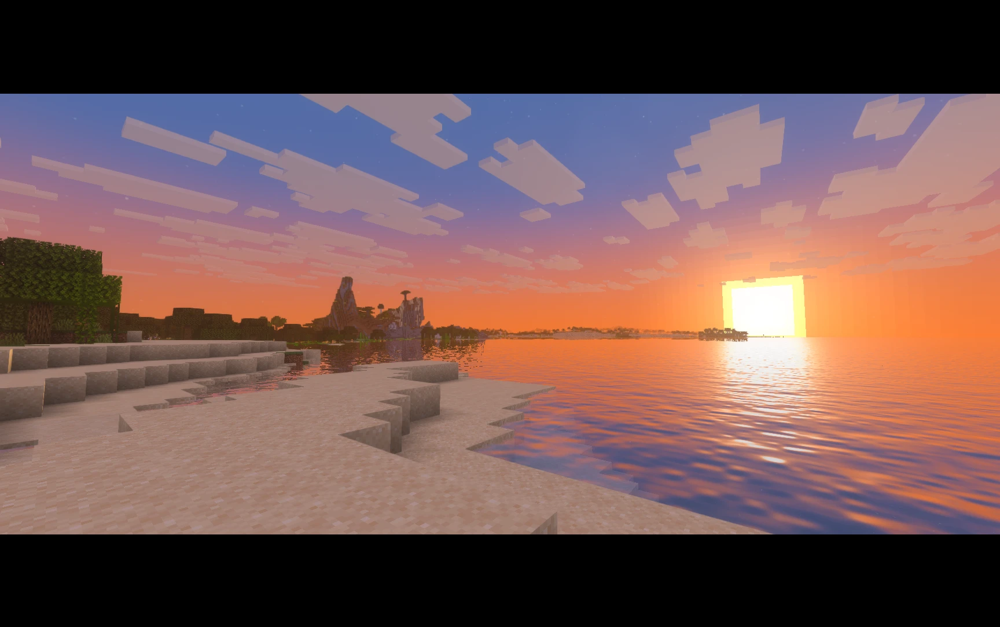

<p align="center"></p>

<h1 align="center">oh shiny!</h1>

<p align="center">A shader pack with colored light, soft shadows and reflective water.<br>Iris &amp; Leadlight &nbsp;|&nbsp; 1.20.1 – 26.3</p>

<p align="center">
<a href="https://modrinth.com/shader/oh-shiny-shaders"></a>
<a href="https://www.curseforge.com/minecraft/shaders/oh-shiny"></a>
<a href="https://github.com/simply-sunny/oh-shiny/releases"></a>
<a href="LICENSE"></a>
</p>

---

The sun and moon cast shadows, soft or in whole pixels. Torches glow orange, soul fire blue, sea lanterns teal and amethyst purple, and a light held in your hand lights up what's around you. Water reflects the world, with ripples and caustics. The sky has a sun glow, sunsets, stars and the Milky Way, and leaves, plants and water move in the wind. Far-off terrain from [Distant Horizons](https://modrinth.com/mod/distanthorizons), and on Iris [Voxy](https://modrinth.com/mod/voxy), is lit and fogged like the rest.

> Made from the shaders that used to be built into [Metallum Extra](https://github.com/ohjey/metallum-extra), by [ohjey](https://github.com/ohjey). Published with ohjey's permission.

## Install

Client-side only. Servers don't need it.

1. Install [Iris](https://modrinth.com/mod/iris) and [Sodium](https://modrinth.com/mod/sodium). On Apple silicon you can use Metallum with [Leadlight](https://github.com/ohjey/leadlight) instead.
2. Download the zip from [Modrinth](https://modrinth.com/shader/oh-shiny-shaders) or [Releases](https://github.com/simply-sunny/oh-shiny/releases).
3. Put it in your `shaderpacks` folder. Don't unzip it.
4. Select it under **Options → Video Settings → Shader Packs**.

| Minecraft | Loader | Tested with |
| --- | --- | --- |
| 1.20.1–26.3 | Iris with Sodium | Iris 1.7.6 on 1.20.1, 1.6.14 on 1.20.2, 1.8.14 on 1.21.1, 1.8.8 on 1.21.4, 1.9.6 on 1.21.8, 1.10.8 on 1.21.11, 1.11.7 with Sodium 0.9.2 on 26.3 |
| 26.1–26.3 | Metallum with Leadlight | Leadlight 0.2.0 on 26.3 |

Zips are named `oh shiny! <version>.zip`. Only 1.5.2 was named `oh shiny 1.5.2.zip`.

## Use

Pick a preset under **Shader Packs → Shader Pack Settings** (Iris calls it Profile). Medium is the default.

| Preset | Shadow Sharpness | Shadow Distance | Water Reflections | Sun Rays | Ambient Occlusion | Mob Shadows |
| --- | --- | --- | --- | --- | --- | --- |
| Low | 1024 | 64 | Off | Off | Off | Off |
| Medium | 2048 | 96 | On | Off | On | On |
| High | 2048 | 128 | On | On | On | On |
| Ultra | 4096 | 192 | On | On | On | On |

- Shadows cost the most. If the game runs slowly, turn off **Mob Shadows**, lower **Shadow Distance**, or turn off **Shadows**.
- Ambient occlusion, sun rays, bloom and water reflections cost nothing when they're off. With Shadows and Colored Light both off, the shadow pass is skipped.
- Beyond the preset, settings sit on seven screens: **Lighting**, **Material**, **Environment**, **Camera**, **Anti-aliasing**, **Color** and **Color Grading**. Lighting opens **Shadow Settings** for the finer shadow options. Everything on Color Grading starts at Normal.
- Parallax Depth costs speed, which is why it starts off. Lower its Quality or Distance first if the game runs slowly with it on.

## Configure

Open **Options → Video Settings → Shader Packs → Shader Pack Settings**.

| Screen | Setting | Default | Notes |
| --- | --- | --- | --- |
| Lighting | Shadows | On | The sun and moon cast shadows. |
| Lighting | Shadow Sharpness | 2048 | The shadow map's size: 1024, 2048 or 4096. |
| Lighting | Shadow Distance | 96 | 32 to 512 blocks. |
| Lighting | Colored Light | On | Each light source glows in its own color. |
| Lighting | Hand Light | On | A light held in your hand lights up what's around you. |
| Lighting | Ambient Occlusion | On | Corners and crevices are a little darker. |
| Material | Resource Pack PBR | On | Bumps, shine, metal and glow from a LabPBR resource pack's normal and specular maps. Nothing happens without such a pack. See [Resource pack PBR](#resource-pack-pbr). |
| Material | Parallax Depth | Off | The pack's height maps make surfaces look deep. Costs speed. |
| Material | Depth | 50% | 10% to 100% of a quarter block. |
| Material | Quality | Medium | Low, Medium or High: 8, 16 or 32 layers. |
| Material | Distance | 32 blocks | 16 to 64 blocks. The depth fades out by then. |
| Shadow Settings | Mob Shadows | On | Mobs, players and block entities cast shadows too. Off on Low. |
| Shadow Settings | Sun Path Tilt | 0° | −60° to 60°. |
| Shadow Settings | Shadow Blur | Off | Off to 4. Blurs shadow edges, which hides their shimmer as you move. Not used with Pixel Shadows. |
| Shadow Settings | Pixel Shadows | Off | Shadows fall in whole texture pixels, with blocky edges. |
| Shadow Settings | Shadow Pixels | 16 | How many shadow pixels fit across a block: 4 to 64. 16 matches the game's textures. |
| Shadow Settings | Soft Pixel Edges | Off | Pixels at a shadow's edge are only as dark as they are covered. |
| Environment | Sun Rays | Off | Sunlight in the air, broken up by trees and openings within Shadow Distance. Needs Shadows. On for High and Ultra. |
| Environment | Sun Ray Strength | Strong | Soft is the air only. Strong and Insane add shafts around the sun, whatever Shadow Distance is. |
| Environment | Fog | Off | 10% to 90%: a haze over that last share of what you can see, far terrain included, thickest in the valleys. |
| Environment | Water Reflections | On | Water mirrors the world around it. |
| Environment | Waving | On | Water ripples, and leaves and plants sway. |
| Camera | Bloom | On | A soft glow around bright things. |
| Camera | Vignette | Normal | Darkens the corners of the picture. |
| Anti-aliasing | FXAA | Off | For when Smooth Edges leaves jagged edges behind. Smooths the whole picture, textures too. Replaces Smooth Edges. |
| Anti-aliasing | TAA | Off | For when far-off blocks shimmer as you move. The smoothest edges, but softer. Can go with FXAA. |
| Anti-aliasing | Smooth Edges | On | Start here. Blends away the stair steps along edges and keeps textures crisp. |
| Anti-aliasing | Sharpening | Off | Up to 100%. Brings back the crispness TAA softens. 30–50% works well with TAA. |
| Color | Sunset Color | Pink | Pink, Orange, Gold, Red, Purple or Blue, in the sky and in the low sun's light. |
| Color | Dark Tint and Bright Tint | Normal | A color laid over the dark or bright parts of the picture, and how much of it. |
| Color Grading | Color Grading | Normal | Exposure, contrast, dark areas, bright areas, saturation, vibrance, temperature, tint and fade. |

Iris saves your choices next to the zip, in `shaderpacks/oh shiny! <version>.zip.txt`. Delete that file to reset to defaults. Each version has its own zip name, so a new version starts from its defaults.

## Resource pack PBR

With a resource pack that has normal and specular maps in the LabPBR 1.3 layout, such as [Vanilla Mashup (PBR)](https://modrinth.com/resourcepack/vanilla-mashup-pbr), blocks get bumps from the normal map, crevice shading from its ambient occlusion, sun highlights and sky reflections from the specular map (smoothness, reflectance and metals), and glow from its emission. Where a texture has no maps, the pack lights it as before. Turn it off under **Material**.

Parallax Depth uses the pack's height maps to make cobblestone, bricks and the like look deep. It needs Iris or Leadlight to pass the tile data of each face to the shader (`mc_midTexCoord`); if it does nothing, that is why.

Only blocks are covered, not entities, held items or Distant Horizons' far-off terrain. Plants, leaves and glass get no parallax. The depth is drawn on the surface and does not change what is in front of what, so edges stay flat. Vanilla Mashup asks you to turn mipmaps off (Options → Video Settings → Mipmap Levels: Off) for the maps to look right.

## Develop

Requires Python 3. `tools/check.py` also needs [glslang](https://github.com/KhronosGroup/glslang).

```bash
python3 tools/check.py && python3 tools/build.py
```

`check.py` compiles every stage, and `build.py` writes the zip to `dist/`. Stage files, Distant Horizons' `dh_*` included, come from `tools/stages.py`, and `block.properties` and `item.properties` come from `tools/blocks.py`. Edit those, not the generated files. Settings and their defaults live in `shaders/lib/settings.glsl`, and their names in `shaders/lang/en_us.lang`.

Release settings and listing copy live in [MODRINTH.md](MODRINTH.md).

## Troubleshooting

| Problem | Fix |
| --- | --- |
| The pack isn't in the list | Put the zip itself in `shaderpacks`, not an unzipped folder. Check that Iris is installed. |
| The game runs slowly | Pick a lower preset, or turn off Mob Shadows, lower Shadow Distance, or turn off Shadows. |
| Shadows shimmer as you move | Raise Shadow Blur, or turn on TAA. |
| Edges look soft with TAA | Raise Sharpening to 30–50%. |
| Far-off terrain has no shadows | Expected with Distant Horizons. See [Limits](#limits). |

Logs are in `.minecraft/logs/latest.log`. Include the log, a screenshot, your GPU and OS, and your Minecraft, Iris or Leadlight, and pack versions when you [report an issue](https://github.com/simply-sunny/oh-shiny/issues).

## Limits

- **Minecraft:** 1.20.1 to 26.3 on Iris, 26.1 to 26.3 on Leadlight.
- **Voxy:** Iris only.
- **Resource pack PBR:** LabPBR 1.3 only, blocks only, and not tested on Leadlight yet. See [Resource pack PBR](#resource-pack-pbr).
- **Distant Horizons:** its far-off terrain casts no shadows. The shadow map only reaches Shadow Distance. It needs Iris 1.7 or later, so not on 1.20.2, and on 1.20.x also [Indium](https://modrinth.com/mod/indium).
- **Clouds turning off after a restart:** reported in [#3](https://github.com/simply-sunny/oh-shiny/issues/3), not reproduced yet.

## License

MIT, see [LICENSE](LICENSE). Copyright © 2026 Metallum Extra contributors.

Content disclosures: ohjey (the original shaders, from [Metallum Extra](https://github.com/ohjey/metallum-extra), MIT), simply-sunny (the standalone pack, its settings and releases). Minecraft is a trademark of Mojang Studios.
