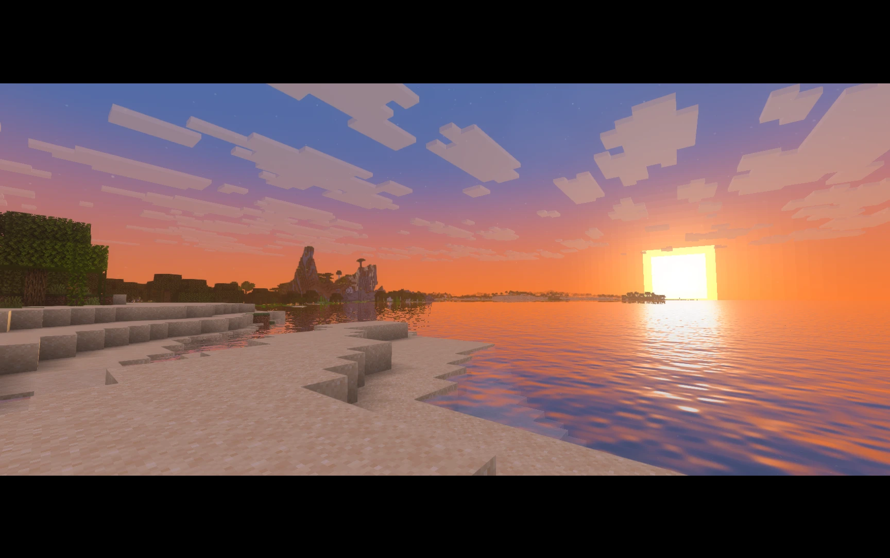

<p align="center"></p>

<h1 align="center">oh shiny</h1>

<p align="center">A shader pack with colored light, soft shadows and reflective water.<br>Iris &amp; Leadlight &nbsp;|&nbsp; 26.1 – 26.3</p>

<p align="center">
<a href="https://modrinth.com/shader/oh-shiny-shaders"></a>
<a href="https://github.com/simply-sunny/oh-shiny/releases"></a>
<a href="LICENSE"></a>
</p>

---

The sun and moon cast shadows, soft or in whole pixels. Torches glow orange, soul fire blue, sea lanterns teal and amethyst purple, and a light held in your hand lights up what's around you. Water reflects the world, with ripples and caustics. The sky has a sun glow, sunsets, stars and the Milky Way, and leaves, plants and water move in the wind. Far-off terrain from [Distant Horizons](https://modrinth.com/mod/distanthorizons), and on Iris [Voxy](https://modrinth.com/mod/voxy), is lit and fogged like the rest.

> Made from the shaders that used to be built into [Metallum Extra](https://github.com/ohjey/metallum-extra), by [ohjey](https://github.com/ohjey). Published with ohjey's permission.

## Install

Client-side only. Servers don't need it.

1. Install [Iris](https://modrinth.com/mod/iris) and [Sodium](https://modrinth.com/mod/sodium). On Apple silicon you can use Metallum with [Leadlight](https://github.com/ohjey/leadlight) instead.
2. Download the zip from [Modrinth](https://modrinth.com/shader/oh-shiny-shaders) or [Releases](https://github.com/simply-sunny/oh-shiny/releases).
3. Put it in your `shaderpacks` folder. Don't unzip it.
4. Select it under **Options → Video Settings → Shader Packs**.

| Minecraft | Loader | Tested with |
| --- | --- | --- |
| 26.1–26.3 | Iris with Sodium | Iris 1.11.7, Sodium 0.9.2 on 26.3 |
| 26.1–26.3 | Metallum with Leadlight | Leadlight 0.2.0 on 26.3 |

Zips are named `oh shiny <version>.zip`. 1.5.1 and earlier were named `oh shiny! <version>.zip`.

## Use

Pick a preset under **Shader Packs → Shader Pack Settings** (Iris calls it Profile). Medium is the default.

| Preset | Shadow Sharpness | Shadow Distance | Water Reflections | Sun Rays | Ambient Occlusion | Mob Shadows |
| --- | --- | --- | --- | --- | --- | --- |
| Low | 1024 | 64 | Off | Off | Off | Off |
| Medium | 2048 | 96 | On | Off | On | On |
| High | 2048 | 128 | On | On | On | On |
| Ultra | 4096 | 192 | On | On | On | On |

- Shadows cost the most. If the game runs slowly, turn off **Mob Shadows**, lower **Shadow Distance**, or turn off **Shadows**.
- Ambient occlusion, sun rays, bloom and water reflections cost nothing when they're off. With Shadows and Colored Light both off, the shadow pass is skipped.
- **Color Grading** has a screen of its own. Everything on it starts at Normal.

## Configure

Open **Options → Video Settings → Shader Packs → Shader Pack Settings**.

| Setting | Default | Notes |
| --- | --- | --- |
| Shadows | On | The sun and moon cast shadows. |
| Mob Shadows | On | Mobs, players and block entities cast shadows too. Off on Low. |
| Shadow Sharpness | 2048 | The shadow map's size: 1024, 2048 or 4096. |
| Shadow Distance | 96 | 32 to 512 blocks. |
| Shadow Blur | Off | Off to 4. Blurs shadow edges, which hides their shimmer as you move. Not used with Pixel Shadows. |
| Pixel Shadows | Off | Shadows fall in whole texture pixels, with blocky edges. |
| Shadow Pixels | 16 | How many shadow pixels fit across a block: 4 to 64. 16 matches the game's textures. |
| Soft Pixel Edges | Off | Pixels at a shadow's edge are only as dark as they are covered. |
| Colored Light | On | Each light source glows in its own color. |
| Hand Light | On | A light held in your hand lights up what's around you. |
| Ambient Occlusion | On | Corners and crevices are a little darker. |
| Sun Rays | Off | Shafts of sunlight through trees, openings and haze. On for High and Ultra. |
| Sun Ray Strength | Insane | Soft is the air only. Strong and Insane add shafts across the picture. |
| Sun Path Tilt | 0° | −60° to 60°. |
| Water Reflections | On | Water mirrors the world around it. |
| Waving | On | Water ripples, and leaves and plants sway. |
| Bloom | On | A soft glow around bright things. |
| Smooth Edges | On | Blends away the stair steps along edges. |
| FXAA | Off | Smooths every edge in the picture. Replaces Smooth Edges. |
| TAA | Off | Temporal anti-aliasing: the smoothest edges, with no shimmer on far-off blocks. |
| Sharpening | Off | Up to 100%. Brings back the crispness TAA softens. 30–50% works well with TAA. |
| Fog | Off | 10% to 90%: a haze over that last share of what you can see, far terrain included, thickest in the valleys. |
| Color Grading | Normal | Exposure, contrast, shadows, highlights, saturation, vibrance, temperature, tint, shadow and highlight color, fade and vignette. |

Iris saves your choices next to the zip, in `shaderpacks/oh shiny <version>.zip.txt`. Delete that file to reset to defaults. Each version has its own zip name, so a new version starts from its defaults.

## Develop

Requires Python 3. `tools/check.py` also needs [glslang](https://github.com/KhronosGroup/glslang).

```bash
python3 tools/check.py && python3 tools/build.py
```

`check.py` compiles every stage, and `build.py` writes the zip to `dist/`. Stage files, Distant Horizons' `dh_*` included, come from `tools/stages.py`, and `block.properties` and `item.properties` come from `tools/blocks.py`. Edit those, not the generated files. Settings and their defaults live in `shaders/lib/settings.glsl`, and their names in `shaders/lang/en_us.lang`.

Release settings and listing copy live in [MODRINTH.md](MODRINTH.md).

## Troubleshooting

| Problem | Fix |
| --- | --- |
| The pack isn't in the list | Put the zip itself in `shaderpacks`, not an unzipped folder. Check that Iris is installed. |
| The game runs slowly | Pick a lower preset, or turn off Mob Shadows, lower Shadow Distance, or turn off Shadows. |
| Shadows shimmer as you move | Raise Shadow Blur, or turn on TAA. |
| Edges look soft with TAA | Raise Sharpening to 30–50%. |
| Far-off terrain has no shadows | Expected with Distant Horizons. See [Limits](#limits). |

Logs are in `.minecraft/logs/latest.log`. Include the log, a screenshot, your GPU and OS, and your Minecraft, Iris or Leadlight, and pack versions when you [report an issue](https://github.com/simply-sunny/oh-shiny/issues).

## Limits

- **Minecraft:** 26.1 to 26.3 only.
- **Voxy:** Iris only.
- **Distant Horizons:** its far-off terrain casts no shadows. The shadow map only reaches Shadow Distance.
- **Clouds turning off after a restart:** reported in [#3](https://github.com/simply-sunny/oh-shiny/issues/3), not reproduced yet.

## License

MIT, see [LICENSE](LICENSE). Copyright © 2026 Metallum Extra contributors.

Content disclosures: ohjey (the original shaders, from [Metallum Extra](https://github.com/ohjey/metallum-extra), MIT), simply-sunny (the standalone pack, its settings and releases). Minecraft is a trademark of Mojang Studios.
